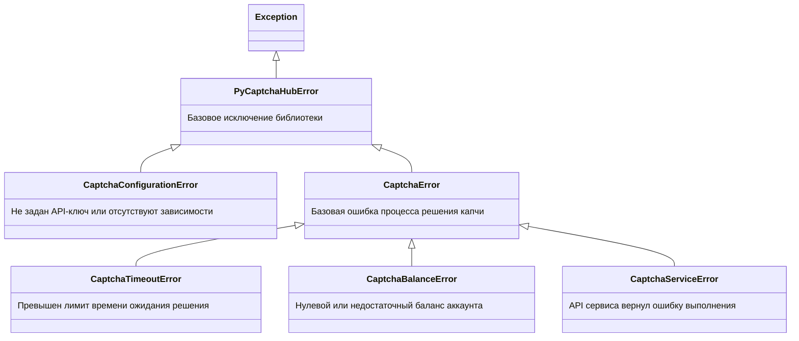

# Исключения и ошибки

Библиотека `pycaptcha-hub` предоставляет структурированную иерархию исключений.

---

## Дерево исключений



---

## Рекомендованный паттерн обработки

```python
from pycaptcha_hub import (
    RuCaptchaSolver,
    CaptchaTimeoutError,
    CaptchaBalanceError,
    CaptchaServiceError,
    CaptchaConfigurationError,
)

try:
    solver = RuCaptchaSolver()
    token = solver.solve_recaptcha(sitekey="...", page_url="...")
except CaptchaConfigurationError as e:
    print(f"Ошибка настройки: {e}")
except CaptchaBalanceError:
    print("Необходимо пополнить баланс аккаунта!")
except CaptchaTimeoutError:
    print("Капча не успела решиться за отведенный таймаут")
except CaptchaServiceError as e:
    print(f"Сервис капчи отклонил запрос: {e}")
```
