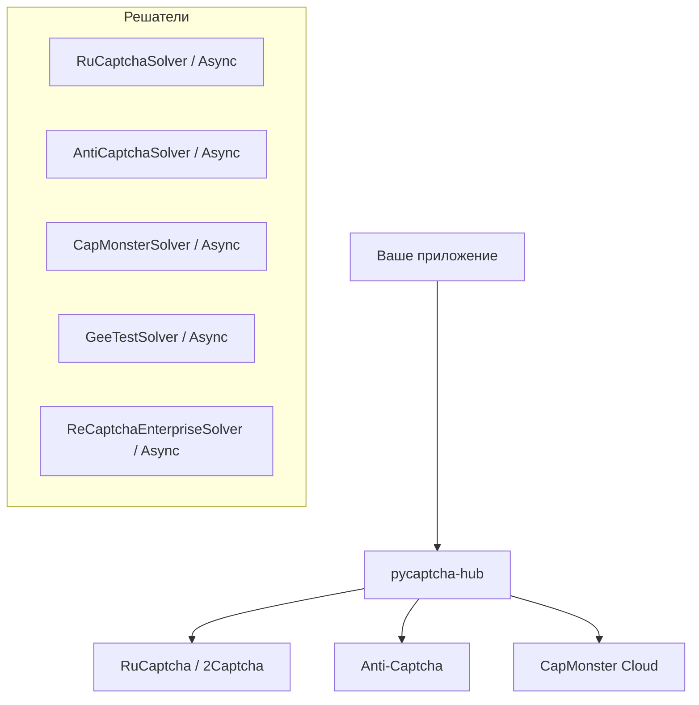

# pycaptcha-hub

Добро пожаловать в документацию библиотеки **pycaptcha-hub**!

`pycaptcha-hub` — современная Python-библиотека для унифицированного взаимодействия с ведущими сервисами автоматического распознавания капч:

- **RuCaptcha / 2Captcha**
- **Anti-Captcha**
- **CapMonster Cloud**

Библиотека разработана с акцентом на надежность, типизацию (`Pydantic`, `py.typed`) и поддержку как классического синхронного кода, так и асинхронных приложений (`asyncio`).

---

## Ключевые возможности

- 🚀 **Синхронный и асинхронный API**: для всех клиентов доступны синхронный (`Solver`) и асинхронный (`AsyncSolver`) варианты.
- 🧩 **Поддержка сложных капч**: полноценная поддержка интерактивных капч **GeeTest v4/v3** и корпоративной **reCAPTCHA Enterprise** с кастомными payload.
- 🛡️ **Строгая валидация**: входные параметры и результаты типизированы Pydantic-моделями (`GeeTestTaskConfig`, `GeeTestResult`, `ReCaptchaEnterpriseConfig`).
- 🔑 **Автоматическое разрешение секретов**: бесшовное чтение ключей из переменных окружения или опционального менеджера секретов `chutils.secret_manager`.
- ⚡ **Легковесность**: минимальный набор зависимостей (`httpx`, `pydantic`), поддержка Python 3.11+.

---

## Архитектура решения

---

## Навигация по документации

- [Быстрый старт](quickstart.md) — установка и базовые примеры использования.
- [Провайдеры и солверы](solvers.md) — обзор клиентов для RuCaptcha, Anti-Captcha и CapMonster.
- [GeeTest v4 / v3](geetest.md) — подробности работы со слайд-капчами GeeTest.
- [reCAPTCHA Enterprise](recaptcha_enterprise.md) — решение enterprise-версий reCAPTCHA.
- [Исключения и ошибки](exceptions.md) — иерархия исключений и стратегия обработки ошибок.
- [Справочник API](api.md) — сигнатуры функций и классов.
